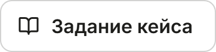
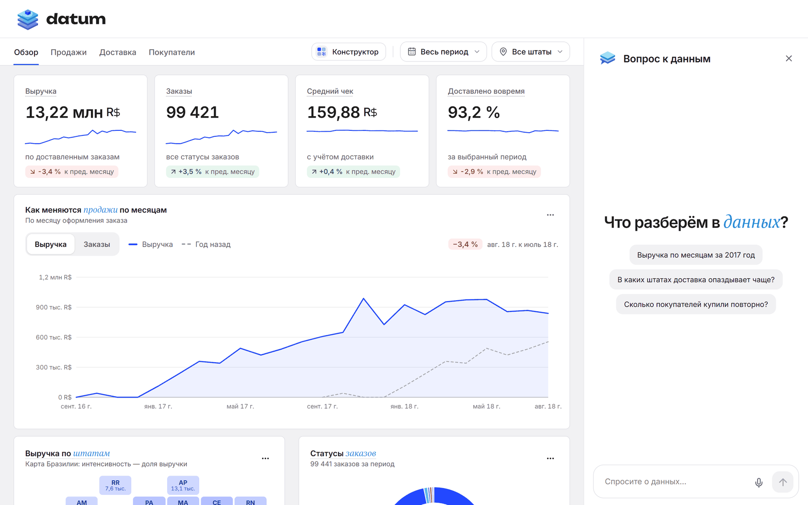
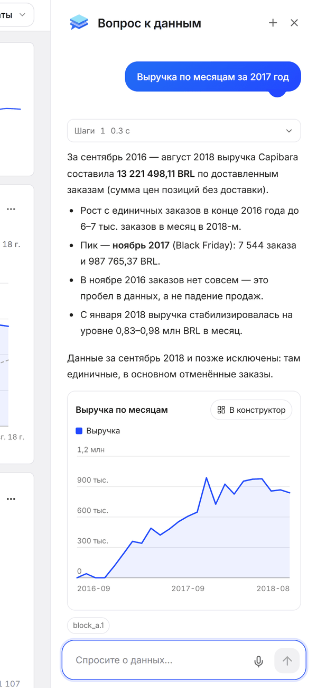
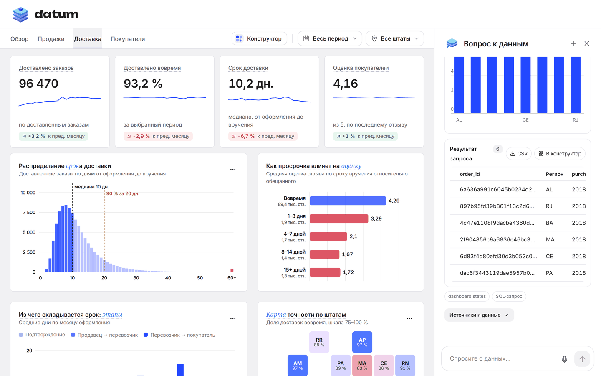
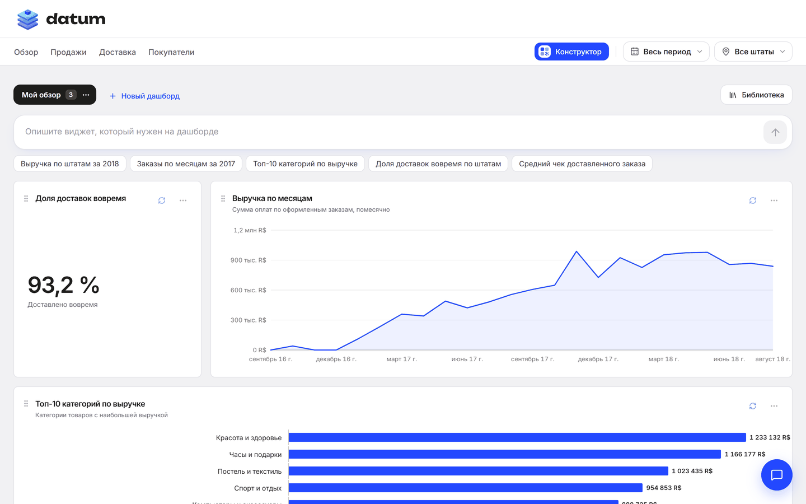
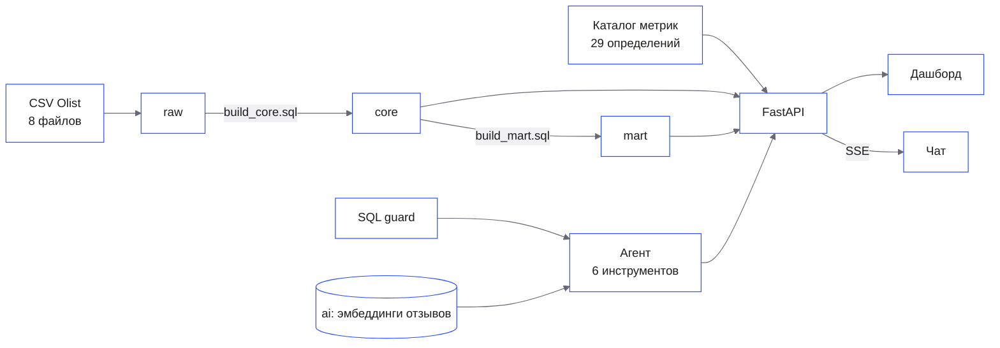

<p align="center">
  <picture>
    <source media="(prefers-color-scheme: dark)" srcset="docs/readme/banner.dark.png">
    
  </picture>
</p>

<p align="center">
  Аналитик маркетплейса открывает дашборд исполнения заказа или задаёт вопрос словами и получает
  цифру вместе с SQL, по которому она посчитана. Дашборд, чат и конструктор работают поверх одной
  модели данных.
</p>

<p align="center">
  <!-- readme:buttons -->
  <a href="#запуск"><picture><source media="(prefers-color-scheme: dark)" srcset="docs/readme/cta-run.dark.png"></picture></a>
  <a href="docs/agent_api.md"><picture><source media="(prefers-color-scheme: dark)" srcset="docs/readme/cta-api.dark.png"></picture></a>
  <a href="docs/handout.md"><picture><source media="(prefers-color-scheme: dark)" srcset="docs/readme/cta-case.dark.png"></picture></a>
  <!-- /readme:buttons -->
</p>

<p align="center">
  <!-- readme:status -->
  <a href="#результаты"><picture><source media="(prefers-color-scheme: dark)" srcset="docs/readme/badge-status-1.dark.png"></picture></a>
  <a href="#данные-и-модель"><picture><source media="(prefers-color-scheme: dark)" srcset="docs/readme/badge-status-2.dark.png"></picture></a>
  <br>
  <a href="backend/catalog"><picture><source media="(prefers-color-scheme: dark)" srcset="docs/readme/badge-status-3.dark.png"></picture></a>
  <a href="#ограничения"><picture><source media="(prefers-color-scheme: dark)" srcset="docs/readme/badge-status-4.dark.png"></picture></a>
  <a href="LICENSE"><picture><source media="(prefers-color-scheme: dark)" srcset="docs/readme/badge-status-5.dark.png"></picture></a>
  <!-- /readme:status -->
</p>

<p align="center">
  <!-- readme:stack -->
  <picture><source media="(prefers-color-scheme: dark)" srcset="docs/readme/badge-stack-1.dark.png"></picture>
  <picture><source media="(prefers-color-scheme: dark)" srcset="docs/readme/badge-stack-2.dark.png"></picture>
  <picture><source media="(prefers-color-scheme: dark)" srcset="docs/readme/badge-stack-3.dark.png"></picture>
  <br>
  <picture><source media="(prefers-color-scheme: dark)" srcset="docs/readme/badge-stack-4.dark.png"></picture>
  <picture><source media="(prefers-color-scheme: dark)" srcset="docs/readme/badge-stack-5.dark.png"></picture>
  <!-- /readme:stack -->
</p>

<p align="center">
  <!-- readme:nav -->
  <a href="#зачем"><picture><source media="(prefers-color-scheme: dark)" srcset="docs/readme/badge-nav-1.dark.png"></picture></a>
  <a href="#как-выглядит"><picture><source media="(prefers-color-scheme: dark)" srcset="docs/readme/badge-nav-2.dark.png"></picture></a>
  <a href="#как-устроено"><picture><source media="(prefers-color-scheme: dark)" srcset="docs/readme/badge-nav-3.dark.png"></picture></a>
  <a href="#запуск"><picture><source media="(prefers-color-scheme: dark)" srcset="docs/readme/badge-nav-4.dark.png"></picture></a>
  <a href="#результаты"><picture><source media="(prefers-color-scheme: dark)" srcset="docs/readme/badge-nav-5.dark.png"></picture></a>
  <a href="#структура"><picture><source media="(prefers-color-scheme: dark)" srcset="docs/readme/badge-nav-6.dark.png"></picture></a>
  <!-- /readme:nav -->
</p>

## Зачем

В маркетплейсе Capibara из кейса RWB каждая подсистема росла отдельно: заказы, платежи, доставка
и отзывы. Поэтому у двух аналитиков на один вопрос выходят две разные цифры. Datum собирает сырую
выгрузку в модель `raw → core → mart` и закрепляет определения метрик: выручка, средний чек,
доставка вовремя. Дашборд, чат и конструктор отвечают из одного каталога метрик, и рядом с каждой
цифрой виден запрос, который её посчитал.

## Как выглядит

<p align="center">
  
</p>

<table>
  <tr>
    <td width="34%" rowspan="2" valign="top"></td>
    <td width="66%" valign="top"></td>
  </tr>
  <tr>
    <td valign="top"></td>
  </tr>
</table>

- **Дашборд.** Вкладки «Обзор», «Продажи», «Доставка» и «Покупатели» с фильтрами по периоду и
  штату. У каждой метрики есть пояснение, что именно посчитано.
- **Чат.** Вопрос словами, ответ таблицей, графиком и блоком источников: SQL, параметры, ID заказов
  и отзывов. Работает и голосом.
- **Конструктор.** Виджет описывается словами, агент собирает его по `core` и `mart`, виджет
  сохраняется в библиотеку и раскладывается на свои дашборды. Ответ из чата переносится туда одной
  кнопкой.
- **Телефон.** Панели идут друг под другом, графики перестраиваются под ширину экрана, чат
  открывается на весь экран.

## Как устроено



- **Модель.** `raw` хранит выгрузку как есть, все колонки `text`. `core` задаёт типы, ключи и
  связи. `mart` добавляет витрины исполнения заказа и отгрузок продавцов.
- **Каталог метрик.** Определения и SQL лежат в [`backend/catalog/`](backend/catalog). Дашборд
  и агент берут цифры оттуда, поэтому на один вопрос они отвечают одинаково.
- **Агент.** OpenAI Agents SDK с инструментами `describe_dataset`, `query_metrics`, `get_order`,
  `execute_sql`, `search_reviews` и `run_quality_checks`. Ответ приходит потоком по SSE.
- **Защита SQL.** Свободный запрос агента проходит разбор AST в
  [`backend/sql_guard.py`](backend/sql_guard.py): один `SELECT`, только `core` и `mart`, функции из
  закрытого списка. Запрос выполняется от роли `agent_reader` в транзакции только для чтения, с
  таймаутом 10 с и лимитом 500 строк.
- **Отзывы.** Поиск по смыслу через pgvector в схеме `ai`. Отзывы считаются данными, а не
  инструкциями, и показываются как примеры, а не как частота жалоб.
- **Языковая модель.** По умолчанию чат идёт через локальный Codex CLI и адаптер
  [`backend/codex_gateway.py`](backend/codex_gateway.py). Вместо него подходит любой
  OpenAI-совместимый endpoint.

## Запуск

Нужны Docker с Compose, Python 3.12+, Node.js с npm и bash: macOS, Linux или WSL2.

```bash
git clone https://github.com/GoatWhistle/rwb.git
cd rwb
bash scripts/bootstrap-demo.sh
bash scripts/run-demo.sh
```

`bootstrap-demo.sh` выполняется один раз: создаёт `.venv` и `.env`, поднимает PostgreSQL, скачивает
данные, загружает `raw`, собирает `core`, выдаёт права агенту и ставит зависимости фронтенда.
`run-demo.sh` запускает сервисы.

| Адрес | Что там |
|---|---|
| http://127.0.0.1:5173 | Datum |
| http://127.0.0.1:8090/docs | API метрик, чата и конструктора |
| http://127.0.0.1:8091/health | адаптер к локальному Codex |

Для чата через Codex выполните `codex login`, подробности в
[docs/RUN_WITH_CODEX.md](docs/RUN_WITH_CODEX.md). Другой провайдер задаётся в `.env` через
`LLM_BASE_URL`, `LLM_API_KEY` и `LLM_MODEL`. Поиск по отзывам требует `POLZA_API_KEY` и индексации
`.venv/bin/python -m backend.reviews index`. Голосовой ввод ставится отдельно:
`bash scripts/setup-voice.sh <каталог с моделью>`.

Интерфейс без бэкенда и базы, на моках из `frontend/mocks/`:

```bash
cd frontend
npm ci --silent
npm run dev:mock
```

Проверки: `.venv/bin/python -m pytest -q` и `npm --prefix frontend run verify`.

## Данные и модель

[Brazilian E-Commerce Public Dataset by Olist](https://github.com/olist/work-at-olist-data):
550 759 строк в восьми файлах, заказы с сентября 2016 по октябрь 2018. Задание и описание полей —
в [docs/handout.md](docs/handout.md), вопросы к модели — в [docs/tasks.md](docs/tasks.md).

| Файл | Что делает |
|---|---|
| [`solution/build_core.sql`](solution/build_core.sql) | Собирает `core` из `raw`: типы, ключи, связи |
| [`solution/build_mart.sql`](solution/build_mart.sql) | Витрины `mart.order_fulfillment` и `mart.seller_shipment` |
| [`solution/answers_block_a.sql`](solution/answers_block_a.sql) | Ответы блока А с разбором |
| [`solution/answers_block_b.sql`](solution/answers_block_b.sql) | Ответы блока Б |
| [`solution/answers.md`](solution/answers.md) | Ответы блока Б и вброса с таблицами |
| [`solution/dashboard.html`](solution/dashboard.html) | Статичный дашборд «Исполнение заказа» |

## Результаты

Блок А сверяется с контрольными цифрами кейса файлом
[`answers_block_a_check.sql`](solution/answers_block_a_check.sql):

| Вопрос | Результат |
|---|---|
| А1. Выручка по месяцам | 24 месяца, ноябрь 2016 пустой, всего 13 221 498,11 R$ |
| А2. Лучший продавец | 226 987,93 R$ |
| А3. Средний чек | 159,88 R$, 1,14 позиции на заказ |
| А4. Повторные покупки | 2 997 из 96 096 покупателей, 3,12 % |
| А5. Категории | 74 категории, крупнейшая 1 233 131,72 R$ |

## Структура

```text
backend/     FastAPI: метрики, чат по SSE, конструктор, агент, SQL guard, поиск по отзывам, голос
  catalog/   определения и SQL метрик
frontend/    React: дашборд, чат и конструктор; mocks/ для режима без бэкенда
solution/    сборка core и mart, ответы блоков А и Б, статичный дашборд
scripts/     подготовка стенда, загрузка raw, запуск, установка голоса
tests/       pytest: метрики, SQL guard, стриминг, инструменты, виджеты
docs/        задание кейса, вопросы, API агента, конструктор, запуск с Codex
```

## Ограничения

- Чату нужна языковая модель. Без неё работает дашборд, а чат сообщает, что модель недоступна.
- Поиск по отзывам требует ключа эмбеддингов и индексации. Остальные инструменты агента работают
  без него.
- Данные заканчиваются августом 2018: в сентябре и октябре в выгрузке только отмены, поэтому эти
  месяцы исключены из показателей.
- Скрипты рассчитаны на bash. На Windows нужен WSL2.

<p align="center">
  <picture><source media="(prefers-color-scheme: dark)" srcset="docs/readme/mark.dark.png"></picture>
  <br>
  <sub>Team GoatWhistle, кейс RWB, 2026. Licensed under <a href="LICENSE">MIT</a>.</sub>
</p>
